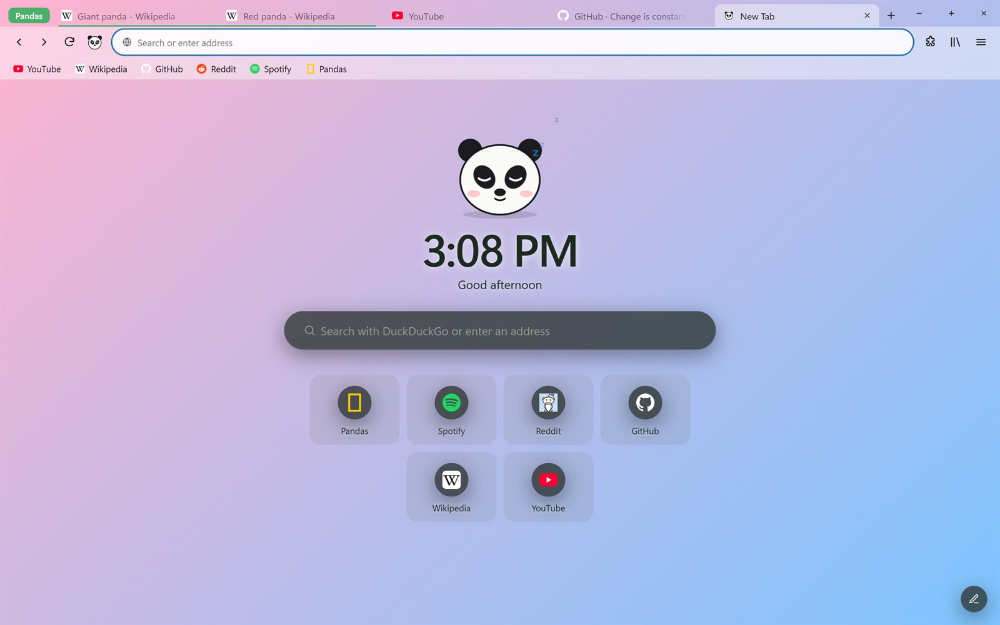
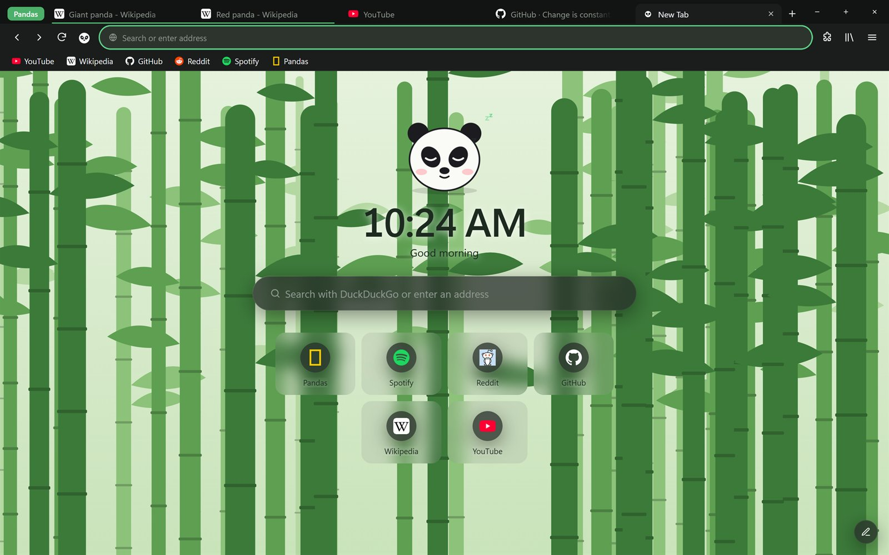
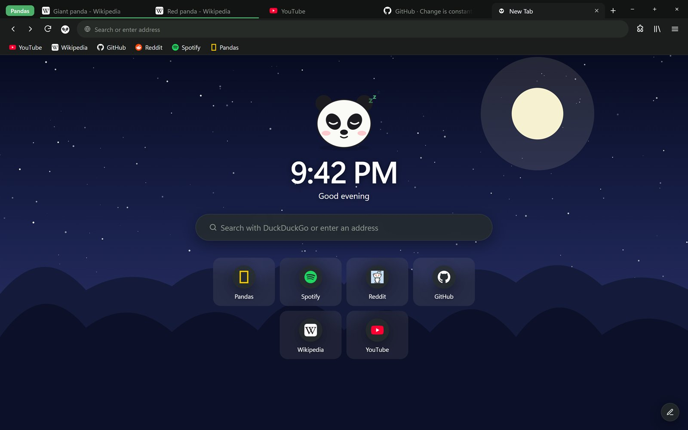
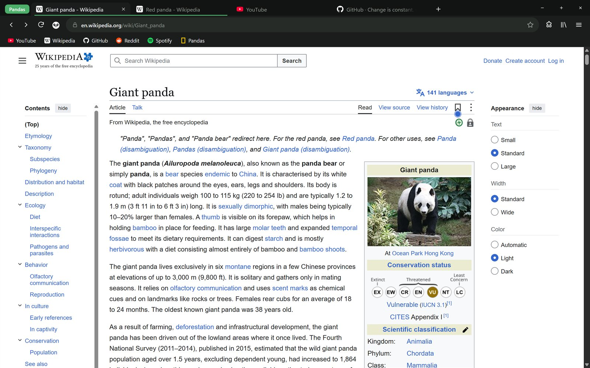
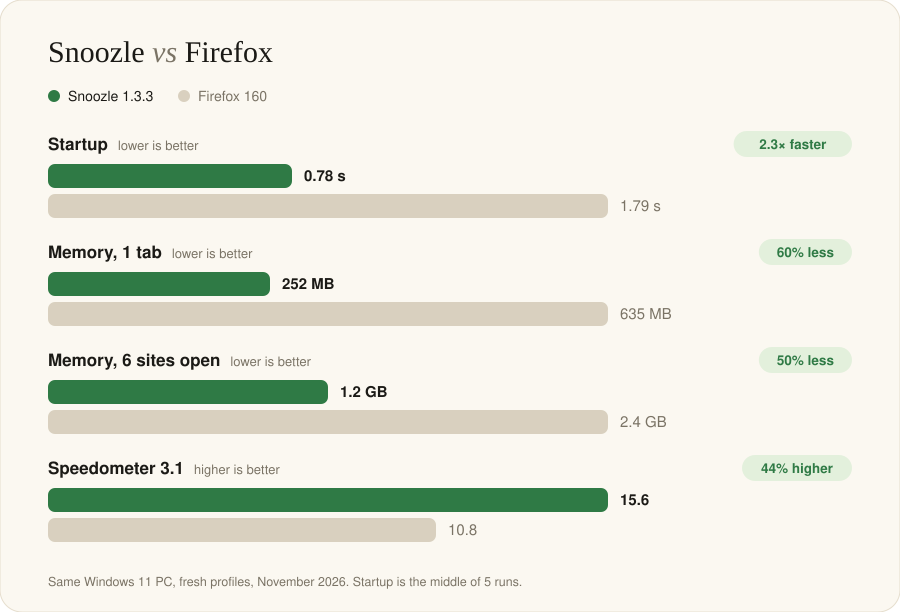

# Snoozle

**A calm, panda-themed web browser for Windows.** 
Wallpapers that flow into your tabs, tab groups, split view, napping tabs and your favourite extensions.

  

 

## Take a look

<table>
<tr>
<td width="50%">
<b>Every new tab is a little nap.</b> A bamboo grove, a clock and your favourite sites.
</td>
<td width="50%">
<b>Night owl?</b> A starry sky, a big moon and dark mode.
</td>
</tr>
<tr>
<td colspan="2">
<b>Out on the web.</b> Tab groups, a bookmarks bar you can drag around, and a clean address bar.
</td>
</tr>
</table>

## How fast is it?

<picture>
  <source media="(prefers-color-scheme: dark)" srcset="shots/bench-dark.svg">
  
</picture>

## What's inside

| | |
|---|---|
| 🗂️ **Tab groups** | Drop a tab onto another to make a group. Name it, colour it, fold it into a tiny pill. Tabs from the same site join in by themselves. |
| 🪟 **Split view** | Two pages side by side in one window. |
| 😴 **Napping tabs** | Tabs you haven't looked at in a while fall asleep to save memory, and wake the moment you click. |
| 🧩 **Your extensions** | Install add-ons from the Firefox store inside Snoozle, like uBlock Origin, SponsorBlock and Dark Reader. They work in private windows too. |
| 📺 **Pop out videos** | Keep watching in a little picture-in-picture window while you browse. |
| 🎨 **Wallpapers & themes** | Pick a scene or mix your own gradient. It flows right up behind your tabs, and every colour follows along. |
| 🕶️ **Private windows** | History, cookies and site data vanish the moment you close it. |
| 🔒 **Site permissions** | Click the lock in the address bar to allow or block camera, microphone, location and notifications. |
| 📁 **Tidy downloads** | Videos, zip files and everything else land in their own folders inside Downloads. |
| ✂️ **Clean links** | Copy a link and the tracking junk (`?utm_source=…`) is stripped off. |
| 🔑 **Passwords** | Snoozle remembers logins and keeps them locked with your Windows account. |
| 🐾 **Small joys** | A paw cursor, soft little sounds, an app icon in any colour, and Mac or Windows style window buttons. |

## Install

1. **Download** [Snoozle-Setup.exe](https://github.com/LavaAKA/snoozle/releases/latest/download/Snoozle-Setup.exe).
2. **Open it.** Snoozle installs just for you, no admin password needed.
3. **Get comfy.** Find Snoozle in the Start menu, and bring your bookmarks over from Chrome or Edge in Settings.

> [!NOTE]
> Snoozle isn't code-signed yet, so Windows may say **"Windows protected your PC"**. Click **More info**, then **Run anyway**.

When a new version comes out, an **Update to…** button appears in Snoozle's tab bar. Updating keeps your tabs, bookmarks and settings.

## Questions

<b>Is Snoozle free?</b>
 Yes, completely. No account, no subscription, no ads of its own.

<b>What is it built on?</b>
 Snoozle is written in Rust and shows pages with Microsoft Edge's WebView2 engine, so sites work just like they do in Edge.

<b>Which extensions work?</b>
 Most popular ones, like uBlock Origin, SponsorBlock, Dark Reader and Unhook. Find them in Add-ons, which searches the Firefox store for you.

<b>Can I bring my bookmarks and passwords?</b>
 Yes. Import bookmarks from Chrome or Edge in Settings, or from a bookmarks file. Passwords come over from a CSV exported by Chrome, Edge or Firefox.

 

**[All versions](https://github.com/LavaAKA/snoozle/releases)** · **[Website](https://lavaaka.github.io/snoozle/)**

This repository holds the Snoozle website and the installer downloads (under Releases).

  

 
<i>zzz…</i>

